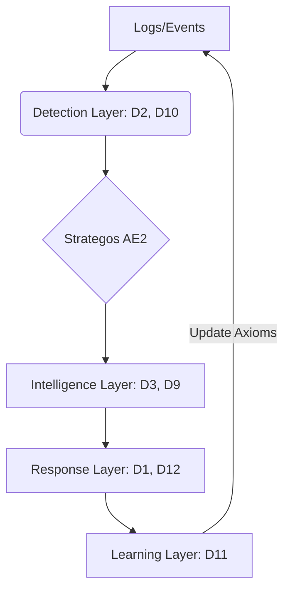

# 🧭 Dalion

> **Multi-agent cybersecurity system with ML-powered threat detection and automated response.**


---

## 🎯 What is Dalion?

**Dalion is a production-ready SOC (Security Operations Center) in software.** 

It deploys 13 specialized AI agents that work together to detect threats, predict attack vectors, and respond automatically—stopping damage before it occurs. Instead of just alerts, Dalion provides **automated containment**.

**Built for:**
- 🏥 **Healthcare** (LGPD/HIPAA compliance)
- 🏦 **Fintech** (Real-time fraud & anomaly detection)
- 🏢 **Enterprises** (Automated SOC scaling)
- 🇧🇷 **Brazilian Markets** (Native LGPD-first architecture)

---

## � Quick Start

### Prerequisites
- **Node.js** ≥ 18
- **Git**

### Installation
```bash
git clone https://github.com/yourorg/dalion.git
cd dalion
npm install
```

### Run Security Detection Demo
Validate the vertical analysis between Dalion Intelligence and Arqos Execution:
```bash
# Injects Dalion agents into the Arqos Engine
node tools/bridge_arqos.js

# Runs the vertical detection & orchestration demo
node tools/demo_vertical.js
```

**Expected output:**
```
✅ Sentinela: Detected 3 anomalies in SSH logs
✅ Strategos: Orchestrating response for 'Starter' tier
✅ Pipeline: Generated containment prompt for Firewall
```

---

## �️ Core Capabilities

### 13 Specialized Intelligence Agents
Dalion uses the **ATLAS Protocol** to coordinate a multidisciplinary team:
- **D1 Infantaria (Dn-SEC-INF)** → First-line response (Rate limiting, IP blocks).
- **D2 Sentinela (Dn-SEC-SNT)** → Real-time anomaly & brute-force detection.
- **D3 Espionagem (Dn-SEC-ESP)** → APT detection & enrichment via 9 intel sources.
- **D9 AttackGraph (Dn-SEC-GRA)** → Predicts the next steps of a multi-stage attack.
- **D10 Ethos (Dn-SEC-ETH)** → Intent classification (Legitimate vs. Malicious).
- **D12 Rottweiler (Dn-SEC-ROT)** → Terminal containment (Defensive-only).

### Key Features
- ⚡ **Ultra-low Latency**: Threat detection and parsing in < 100ms.
- 🧠 **Predictive Defense**: Attack graph generation to stay ahead of adversaries.
- 🔒 **Sovereign Control**: Runs locally via Arqos Engine (LITE mode) for total data privacy.
- 📊 **Self-Refining**: AfterAction agent (Dn-SEC-AFT) learns from every incident.

---

## 📦 Product Tiers

| Feature | Starter | Pro | Enterprise |
| :--- | :---: | :---: | :---: |
| **Real-time Detection** | Basic (4 agents) | Full (13 agents) | Full + Custom |
| **Threat Intel** | ❌ | 3 Sources | 9+ Sources |
| **Attack Prediction** | ❌ | ❌ | ✅ (AttackGraph) |
| **Response Level** | Alert only | Deterrence | Terminal (Bite) |
| **Governance** | Manual | Automated | Full Compliance |
| **Deployment** | Local | Cloud / Hybrid | Managed SOC |

---

## 🏗️ Architecture


---

## � Legal & Compliance

**Dalion is explicitly Defensive-Only:**
- ✅ **No Offensive Actions**: No counter-hacking or external scanning.
- ✅ **Authorized Perimeter**: Only acts within your infrastructure.
- ✅ **Full Audit Trail**: Every decision is logged and traceable.
- ✅ **LGPD/GDPR**: Privacy by design, no PII extraction.

---

## 📚 Documentation
- [Installation Guide](./docs/01-install.md)
- [How to Use](./docs/02-how-to-use.md)
- [Licensing & Tiers](./docs/05-licensing-tiers.md)
- [Architecture Axioms](./docs/00-overview.md)

---

**Built with CodeArk Framework**  
🏰 [codeark.com.br](https://codeark.com.br)

**The only SOC that predicts attacks before they happen.**
